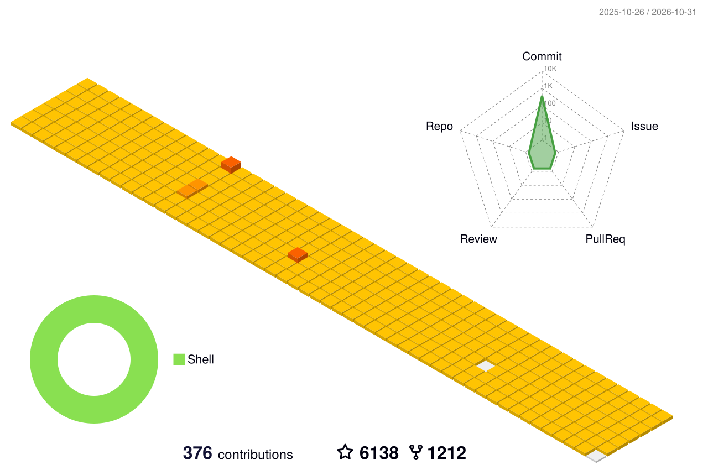
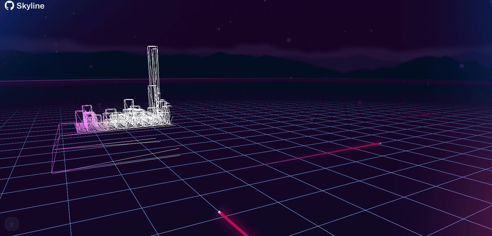

# 🙋 Hello 
欢迎来到Breeze的主页 😝
<h1 align="center">
  
</h1>
<!-- 敲代码的图片 -->

  

<!-- 个人资料徽标 -->

  &emsp;
  
<!-- 贪吃蛇代码贡献图 -->
<!--   GitHub stats graph -->
### 📈 GitHub Activity Graph:

<!--   green snake -->

<!--   stats + languages -->
| .                                                                                                                                       | .                                                                                                                         |
|-----------------------------------------------------------------------------------------------------------------------------------------|---------------------------------------------------------------------------------------------------------------------------|
|  |  |

</img>

<!-- dark snake -->

<!--   profile-green-animate -->

<!--   grid-snake  -->

<!--   skyline 

-->

<!--  TOP codersrank для обновления картинки нужно обновить профиль на странице https://profile.codersrank.io/user/bepb-->

</img>
<!--  2d history skills для обновления картинки нужно обновить профиль на странице https://profile.codersrank.io/user/bepb-->
</img>

**📫 How to Reach me:**

Trophy: Github Profile Trophy

 

&emsp;&emsp;

🧠 计划学习:

&emsp;&emsp;
睡觉

🧰 常用的工具:

&emsp;&emsp;

